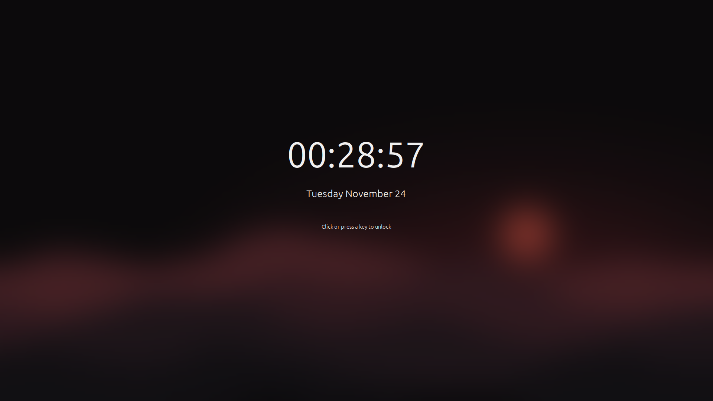

# Nightfall

A black-and-red theme for Ubuntu GNOME 50. It includes the desktop, lock and sign-in backgrounds, application and tray icons, terminal palette, and menus.


Run `./install` in your graphical session and sign in again. Ubuntu asks for administrator approval for theme dependencies and the shared sign-in screen. The selected wallpaper and five alternatives are in your Pictures folder under `backgrounds`.

For one continuous background across monitors, select **Nightfall Panorama** in Settings → Appearance. The included 5120 × 1440 image fits two side-by-side QHD monitors. To export a copy for another arrangement, pass its combined width and height, including any vertical offsets.

```sh
./span-wallpaper 7680x1440 nightfall-triple.png
```

To keep the sun on a particular monitor, pass its dimensions and its offset from the canvas's top-left corner. This example places it on the middle QHD screen of a 6200 × 1920 desktop with a portrait display on the left.

```sh
./span-wallpaper 6200x1920 nightfall-primary.png --primary 2560x1440+1080+217
```

For a custom export, select the image as your wallpaper and run `gsettings set org.gnome.desktop.background picture-options 'spanned'`. The renderer uses Python 3 and Pillow.

Run `./restore` to restore the preceding desktop settings. The installer keeps its local restoration record in the user state directory.


