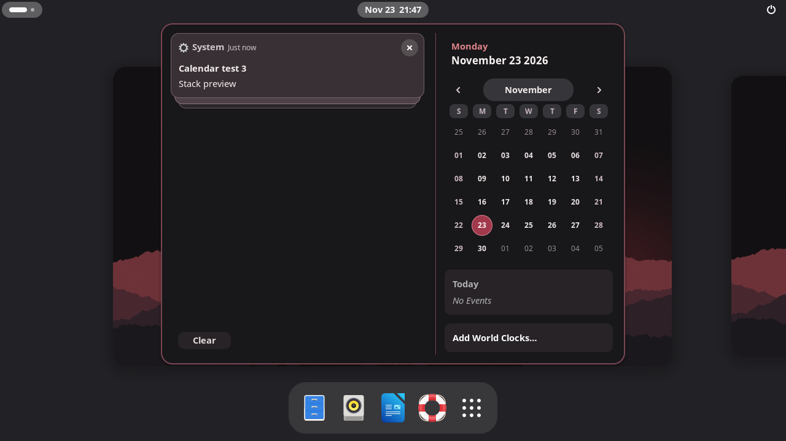

# Nightfall

A black-and-red theme for Ubuntu GNOME 50. It includes the desktop, lock and sign-in backgrounds, application and tray icons, terminal palette, and menus.

Run `./install` in your graphical session and sign in again. Ubuntu asks for administrator approval for theme dependencies and the shared sign-in screen. The selected wallpaper and four alternatives are in your Pictures folder under `backgrounds`.

Run `./restore` to restore the preceding desktop settings. The installer keeps its local restoration record in the user state directory.

